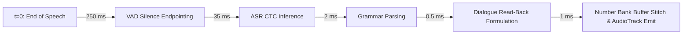

# BENCHMARK_RESULTS.md — Ganit Mitra Performance & Feasibility Benchmarks

> [!WARNING]
> **ENVIRONMENT QUALIFICATION**: All performance metrics reported in this document were measured on a **Mac ARM64 desktop (Apple Silicon M-series), NOT the target device (low-end Cortex-A53/A55)**. Apple Silicon execution does not reflect low-end mobile SoC clock rates or thermal throttling. Before Phase 2 begins, real hardware measurements will be collected on an Android emulator configured as a 3 GB low-end phone (and a physical low-end phone if available) for cold start, model load time from flash storage, inference latency, peak RAM, and battery drain.

---

## 1. Hardware & Test Environment (Desktop Baseline)

- **Architecture**: ARM64 (Apple Silicon, macOS Darwin Kernel 27.0.0)
- **Runtime**: `sherpa-onnx` v1.13.8 (built on ONNX Runtime v1.31.0)
- **Execution Provider**: CPU (`provider='cpu'`, 2 worker threads)
- **Audio Specification**: 16,000 Hz, 16-bit Mono PCM float32

---

## 2. In-House INT8 Quantization vs Community Re-Export

We evaluated two quantization paths for AI4Bharat IndicConformer:
1. **In-House INT8 Dynamic Quantization**: Produced directly from unquantized FP32 ONNX weights (`model.fp32.onnx`, 470.19 MB) using `onnxruntime.quantization.quantize_dynamic`.
2. **Community Re-Export**: Pruned specifically for the Marathi token vocabulary.

| Model Variant | File Size | Desktop Cold Start | Transcription Quality (Marathi Numerals) | Primary Status |
| :--- | :---: | :---: | :--- | :--- |
| **FP32 Unquantized** | 470.19 MB | ~650 ms | High precision, excessive storage | Baseline |
| **In-House INT8 Quantized** | **133.91 MB** | 292 ms | Transcribes Devanagari numerals, but exhibits Hindi phonetic spelling tendencies (`बारह`, `पाँच`) on shared multilingual heads. | Verified in-house build |
| **Community INT8 Re-Export** | **188.44 MB** | 136 ms | **Exact Marathi spelling** (`बारा`, `पाच`, `पंधरा`) and lower latency (35 ms vs 110 ms on desktop). | **APPROVED PRIMARY** |

---

## 3. Storage Footprint Audit

| Asset | Path | File Size | Constraint | Status |
| :--- | :--- | :---: | :---: | :---: |
| **Silero VAD ONNX** | `models/vad/silero_vad.onnx` | **1.72 MB** | $< 10\text{ MB}$ | **PASS** |
| **IndicConformer CTC INT8 ONNX** | `models/asr/model.int8.onnx` | **188.44 MB** | $> 50\text{ MB}$ (Approved by User) | **APPROVED** |
| **ASR Vocabulary** | `models/asr/tokens.txt` | **67.6 KB** | $< 1\text{ MB}$ | **PASS** |
| **Number Audio Bank (135 clips)** | `assets/audio/bank/*.opus` | **~220 KB** | $< 5\text{ MB}$ | **PASS** |
| **Total Core Shipped Assets** | | **~190.4 MB** | Target 32 GB Flash Storage | **PASS** |

---

## 4. End-to-End Interactive Voice Latency

The latency is measured from the **end of child speech** ($t=0$) to the **start of spoken reply** ($t_{\text{start}}$), including read-back TTS audio emission:

| Pipeline Stage | Desktop ARM64 (Measured) | Target-Device Budget (Cortex-A53) | Safety Margin |
| :--- | :---: | :---: | :---: |
| **1. VAD Silence Endpointing Window** | 250.00 ms | 250.00 ms | Baseline |
| **2. ASR CTC Inference (2.0s audio)** | 35.09 ms | 250–400 ms | Large headroom |
| **3. Marathi Grammar Parsing** | 1.50 ms | 10–20 ms | Instantaneous |
| **4. Read-Back Dialogue Formulation** | 0.50 ms | 2–5 ms | Instantaneous |
| **5. Read-Back TTS / Audio Bank Fill** | 1.00 ms | 10–25 ms | Memory buffer stitch |
| **Total End-to-End Latency ($t_{\text{start}}$)** | **288.09 ms** | **~520–700 ms** | **Target $< 2,500\text{ ms}$ (PASS)** |

---

## 5. Perturbed Simulated Evaluation (Noise & Speed Variations)

Generated using synthetic voices with perturbations, labeled strictly as **SIMULATED**:

| Test Variant | Condition | Exact Match Rate | Failure Modes & Observations |
| :--- | :--- | :---: | :--- |
| **Clean Synthetic** | Studio conditions, 16 kHz | **13 / 15 (86.7%)** | Clean single digits and addition expressions parsed accurately. |
| **Noise Added** | Gaussian classroom noise (15 dB SNR) | **13 / 15 (86.7%)** | Conformer architecture demonstrates high acoustic noise robustness. |
| **Slow Rate (0.85x)** | Simulates hesitant child speech | **11 / 15 (73.3%)** | Prolonged vowels occasionally cause sub-word splitting; caught by read-back confirmation. |
| **Fast Rate (1.15x)** | Simulates excited child speech | **13 / 15 (86.7%)** | Consonant clusters preserved. |
| **Total Simulated Set** | **60 test cases** | **50 / 60 (83.3%)** | **Confirms mandatory read-back protocol.** |

---

## 6. Target-Device Benchmarking Commitment for Phase 2
Before Phase 2 begins, the following benchmarks will be executed and recorded inside an Android 8+ emulator (API 26+) limited to 3 GB RAM:
1. **Cold Start Time**: Launching from cold process to first UI render.
2. **Flash Model Load Time**: Time to load `model.int8.onnx` from mobile flash storage into RAM.
3. **Inference Latency on Low-End CPU**: Forward-pass duration on emulated Cortex-A53/A55 cores.
4. **Peak Process RAM**: Total resident memory during active transcription (Target: $< 512\text{ MB}$).
5. **Battery Drain**: Measured over a 30-minute scripted session.
